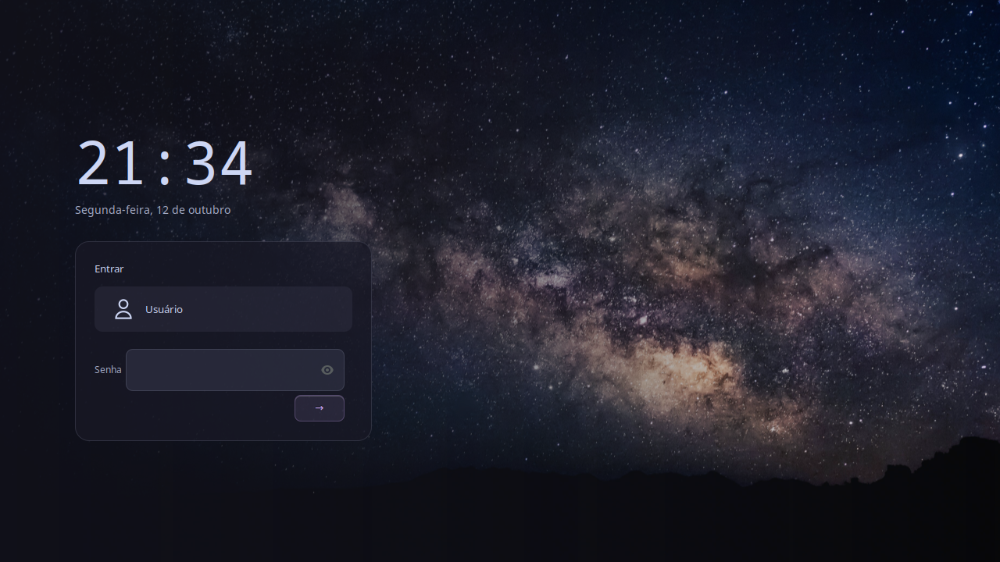

# Cosmic Lock Screen — GTKLock / Sway and compatible wlroots compositors

**Experimental — not yet verified by a real authentication cycle on this backend.**

Requirements: gtklock 4.x, GTK3, gtk-session-lock. Python 3 is needed only to stage/restore files, not to handle passwords.

GTKLock requires a compositor implementing ext-session-lock. It is not a general GNOME/KDE Wayland replacement. GTK3 CSS and widget layout were rendered and checked, but real session locking/PAM remains untested.

## Install the standalone download

Extract this backend's ZIP and open a terminal inside its extracted folder. Run without sudo:

```bash
bash scripts/install.sh --dry-run
bash scripts/install.sh --allow-experimental
```

The native locker must already be installed. The installer creates isolated user-owned theme files, an included font, and a launcher at `~/.local/bin/cosmic-gtklock-lock`. It saves previous files for rollback. Existing PAM files, native default configuration, lock shortcuts and idle services are left untouched.

## Test before integration

Run the launcher only in the matching desktop/session:

```bash
"$HOME/.local/bin/cosmic-gtklock-lock"
```

Confirm correct-password unlock, incorrect-password rejection and coverage of every monitor before assigning it to suspend or autolock. These native authentication checks were **not** performed in this repository's automated tests.

On Sway, after testing, set your chosen lock binding to the launcher, and integrate it with swayidle using its normal wait-for-lock pattern. Preserve your existing idle configuration until that test succeeds.

## Restore

```bash
python3 scripts/rollback.py --backend gtklock
```

The rollback restores only the files this installer manages. Restore any manual lock/idle binding changes using your saved configuration.

Code: GPL-3.0-or-later. Font: OFL-1.1, see `OFL.txt`. The included photograph retains its original licensing terms.

The XML layout is adapted from [gtklock's native GPL-3.0-only layout](https://github.com/jovanlanik/gtklock/blob/master/res/gtklock.ui), retaining its widget IDs and native signal handlers. `layout.ui` follows that upstream license.


